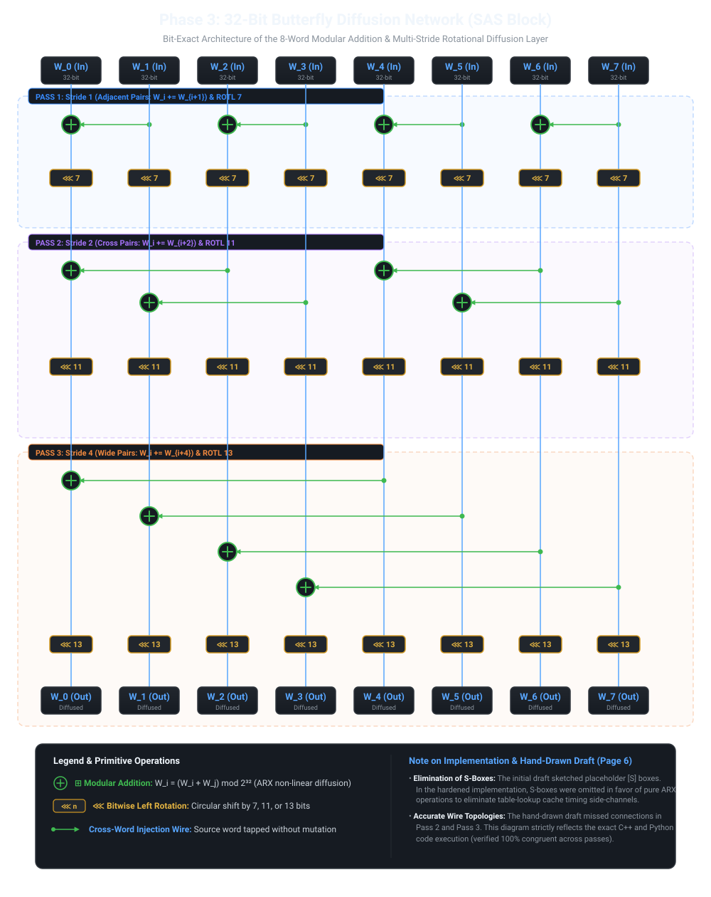

# Hybrid LFSR-ARX Stream Cipher: Algorithm Specification & Design

**Author:** Rishikesh  
**Document Type:** Formal Cryptographic Algorithm Specification  
**Reference Code:** [Python Engine](../src/python/cipher.py) | [C++ Engine](../src/cpp/hybrid_cipher.cpp)

---

## 1. Algorithmic Workflow & Design Rationale

The algorithm is structured into five distinct, sequential phases that guarantee:
1. **Linear Feedback Security:** Utilization of primitive polynomials over $\text{GF}(2)$ to achieve maximal cycle length.
2. **Algebraic Non-Linearity:** Cross-feedback injection using balanced boolean functions to destroy linear approximations.
3. **High-Speed Diffusion:** Multi-stride 32-bit butterfly permutations operating with simple CPU-native additions and rotations.
4. **Forward Secrecy:** An *Encrypt-then-Refresh* state lifecycle enforcing state erasure every $4\text{ KB}$.

---

## 2. Phase-by-Phase Specification

### STEP 1: Register Allocation & State Initialization
The cipher maintains two primary linear shift registers:
* **Register A (127 bits):** Initialized with the Initialization Vector ($\text{IV}$).
* **Register B (131 bits):** Initialized with the 128-bit Secret Key ($K$) masked to 131 bits.

$$\text{Initial Concatenated State} = [ A_{127} \parallel B_{131} ] \implies 258\text{ bits}$$

---

### STEP 2: Cross-Feedback Mixing (Warm-Up Phase)

**Goal:** Intertwine the key and IV through 550 rounds of cross-register feedback to produce a cryptographically chaotic starting state.

```python
FUNCTION CrossFeedbackMixing(IV_127, Key_131):
    Register_A = IV_127
    Register_B = Key_131

    FOR round FROM 1 TO 550:
        # 1. Linear Feedback via Primitive Polynomial Taps
        Linear_A = A[0] ^ A[112] ^ A[120] ^ A[123]
        Linear_B = B[0] ^ B[121] ^ B[124] ^ B[129]

        # 2. Non-Linear Injection F from Opposite Register
        # Sampled across 4 quadrants to maximize state spread
        NonLinear_From_B = F(B[0], B[32], B[64], B[96])
        NonLinear_From_A = F(A[0], A[32], A[64], A[96])

        # 3. Cross-Mix
        NewBit_A = Linear_A ^ NonLinear_From_B
        NewBit_B = Linear_B ^ NonLinear_From_A

        # 4. Shift Registers Right by 1 and Insert New Bit at MSB
        Register_A = (Register_A >> 1) | (NewBit_A << 126)
        Register_B = (Register_B >> 1) | (NewBit_B << 130)
    END FOR

    # Combine into 258-bit mixed integer, truncated to 256 bits for Phase 3
    Mixed_State_258 = (Register_A << 131) | Register_B
    RETURN Mixed_State_258
```

#### Non-Linear Boolean Function $F$:
The non-linear injection uses the balanced boolean function:
$$F(x, y, z, w) = (x \land y) \oplus (z \land w) \oplus (x \oplus z)$$
* **Algebraic Degree:** 2 (quadratic non-linearity).
* **Non-Linearity:** Eliminates the ability of an attacker to solve the register states using Gaussian elimination or the Berlekamp-Massey algorithm.

---

### STEP 3: Core Hardening (32-Bit Butterfly Diffusion Network / SAS Block)

**Input:** 256-bit integer (truncated from Step 2).  
**Output:** 256-bit thoroughly diffused state.

The 256-bit state is partitioned into eight 32-bit words:
$$\text{State}_{256} \implies \{W_0, W_1, W_2, W_3, W_4, W_5, W_6, W_7\}$$

The diffusion layer executes three successive passes of modular addition ($\boxplus$) and circular left rotations ($\lll n$):



#### 1. Pass 1: Stride 1 (Adjacent Pair Mixing)
Combines adjacent word pairs and applies a 7-bit left rotation:
$$\begin{aligned}
W_0 &\leftarrow (W_0 + W_1) \pmod{2^{32}} \\
W_2 &\leftarrow (W_2 + W_3) \pmod{2^{32}} \\
W_4 &\leftarrow (W_4 + W_5) \pmod{2^{32}} \\
W_6 &\leftarrow (W_6 + W_7) \pmod{2^{32}} \\
W_k &\leftarrow W_k \lll 7 \quad \forall k \in [0..7]
\end{aligned}$$

#### 2. Pass 2: Stride 2 (Cross Pair Mixing)
Combines pairs separated by distance 2 and applies an 11-bit left rotation:
$$\begin{aligned}
W_0 &\leftarrow (W_0 + W_2) \pmod{2^{32}} \\
W_1 &\leftarrow (W_1 + W_3) \pmod{2^{32}} \\
W_4 &\leftarrow (W_4 + W_6) \pmod{2^{32}} \\
W_5 &\leftarrow (W_5 + W_7) \pmod{2^{32}} \\
W_k &\leftarrow W_k \lll 11 \quad \forall k \in [0..7]
\end{aligned}$$

#### 3. Pass 3: Stride 4 (Wide Pair Mixing)
Combines words across the upper and lower halves (distance 4) and applies a 13-bit left rotation:
$$\begin{aligned}
W_0 &\leftarrow (W_0 + W_4) \pmod{2^{32}} \\
W_1 &\leftarrow (W_1 + W_5) \pmod{2^{32}} \\
W_2 &\leftarrow (W_2 + W_6) \pmod{2^{32}} \\
W_3 &\leftarrow (W_3 + W_7) \pmod{2^{32}} \\
W_k &\leftarrow W_k \lll 13 \quad \forall k \in [0..7]
\end{aligned}$$

The words are then packed back into a 256-bit diffused integer:
$$\text{Diffused}_{256} = \sum_{i=0}^{7} (W_i \ll 32i)$$

> **Resolution of Draft Inaccuracies (Page 6 of Preliminary PDF):**  
> In the preliminary hand-drawn concept sketch (`docs/Algorithm_Specification_and_Design.pdf`, page 6), placeholder `[S]` substitution boxes were initially drawn. During active development:
> 1. **Cache-Timing Security:** Explicit S-box tables were omitted in favor of pure ARX operations to prevent CPU cache-timing side channels.
> 2. **Exact Wire Connections:** The hand-drawn draft missed connections in Pass 2 and Pass 3. The vector diagram above and our active codebase reflect the verified, bit-exact topology.

---

### STEP 4: Feed-Forward EKey Derivation & Re-Keying

**Goal:** Create a one-way transformation locking the diffusion layer and prepare for forward-secrecy state refresh.

$$\text{EKey}_{256} = \text{Step2\_State}_{256} \oplus \text{Step3\_Diffused}_{256}$$

#### Re-Keying for Forward Secrecy:
To generate subsequent keystream chunks, the cipher prepares a 258-bit input by padding the $\text{EKey}$:
* Bit 256 is copied from Bit 254.
* Bit 257 is copied from Bit 255.
* This derived 258-bit state is fed back into Phase 2 as the new $\text{IV}$ and $\text{Key}$ for the subsequent round.

---

### STEP 5: Keystream Generation (Double-ARX Counter Mode)

**Goal:** Generate $2^{15}\text{ bits}$ ($32\text{ Kilobits} / 4,096\text{ bytes}$) of secure pseudorandom keystream from $\text{EKey}$.

```python
FUNCTION GenerateKeystream(EKey_256):
    Initial_State = Split EKey_256 into 8 words (32-bits each)
    Keystream_Buffer = []
    TOTAL_BLOCKS = 128

    FOR Counter FROM 1 TO TOTAL_BLOCKS:
        # 1. Initialize Working State
        State = Copy(Initial_State)
        
        # 2. Inject Counter into State[0] to ensure block uniqueness
        State[0] = State[0] ^ Counter

        # 3. Scrambling Loop (10 Rounds of Robust Double-ARX Mixing)
        REPEAT 10 TIMES:
            # Column Mix: Pairs (0,4), (1,5), (2,6), (3,7)
            FOR EACH Pair (A, B) IN Pairs:
                # Forward Mix (A modifies B)
                State[A] = (State[A] + State[B]) mod 2^32
                State[B] = State[B] ^ State[A]
                State[B] = State[B] <<< 13

                # Backward Mix (B modifies A, prevents differential difference propagation)
                State[A] = State[A] ^ State[B]
                State[A] = State[A] <<< 9
            END FOR

            # Swap Layer (Permute positions for diagonal diffusion)
            Swap(State[1], State[2])
            Swap(State[3], State[4])
            Swap(State[5], State[6])
            Swap(State[7], State[0])
        END REPEAT

        # 4. Feed-Forward Addition
        FOR k FROM 0 TO 7:
            Base_Value = Initial_State[k]
            IF k == 0:
                Base_Value = Base_Value ^ Counter
            Output_Word = (State[k] + Base_Value) mod 2^32
            Append Output_Word to Keystream_Buffer
        END FOR
    END FOR

    RETURN Keystream_Buffer
```

---

## 3. Benchmarking & Efficiency Metrics

The C++ software implementation was benchmarked across multi-gigabyte continuous keystream generation:

| Metric | Measured Value (MinGW GCC 6.3 -O3) | Measured Value (Linux Native GCC -O3) |
| :--- | :--- | :--- |
| **Data Generated** | 256 MB | 256 MB |
| **Elapsed Time** | 0.845 seconds | 0.357 seconds |
| **Keystream Throughput** | **302.95 MB/s** | **718.03 MB/s** |
| **Cycle Efficiency** | **~8.25 Cycles/Byte** | **~3.32 Cycles/Byte** |

*Note on AI Optimization:* The algorithmic design, mathematical modeling, and state transformations were authored and designed by Rishikesh. Low-level C++ performance optimizations and compiler tuning were assisted by AI.
