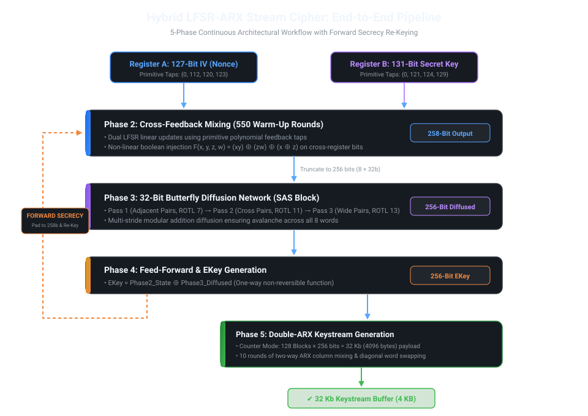

# System Architecture: Hybrid LFSR-ARX Stream Cipher

This document provides the mathematical specification, architectural workflow, and security analysis for the **Hybrid LFSR-ARX Stream Cipher**.

---

## 1. Design Motivation

Traditional stream ciphers face trade-offs between hardware simplicity, statistical period length, and software execution speed:
* **Linear Feedback Shift Registers (LFSRs):** Provide provable maximal period lengths with minimal circuitry, but linear feedback is easily broken via the Berlekamp-Massey algorithm if output is directly observed.
* **Traditional Table-Based Software Ciphers:** Fast due to byte-level memory swaps, but vulnerable to state recovery attacks, statistical key biases, and lack forward secrecy.
* **Our Solution:** A hybrid architecture combining:
  1. **LFSR primitive polynomials** for guaranteed astronomical period length.
  2. **Non-linear cross-feedback injection** to defeat linear cryptanalysis.
  3. **32-bit ARX (Add-Rotate-Xor) operations** for ultra-fast software diffusion and resistance against differential attacks.
  4. **Encrypt-then-Refresh state re-keying** for provable Forward Secrecy.

---

## 2. System Parameters

| Parameter | Specification | Purpose |
| :--- | :--- | :--- |
| **User Key** | 128 bits | Cryptographic secret (mapped into a 131-bit register) |
| **Initialization Vector (IV)** | 127 bits | Nonce / counter ensuring unique keystream per session |
| **Internal State** | 258 bits ($127 + 131$) | Scrambled state truncated to 256 bits |
| **Keystream Chunk** | $2^{15}$ bits (32 Kb / 4,096 bytes) | Generated per round before mandatory state destruction |
| **Re-Keying Interval** | Every 4,096 bytes | Guarantees Forward Secrecy |

---

## 3. Five-Phase Algorithmic Pipeline

### Phase 1: Setup & Primitive Polynomial Taps
The internal registers are initialized from the IV and Key:
* **Register A (127-bit IV):** Derived from primitive polynomial taps:
  $$\text{Taps}_A = \{0, 112, 120, 123\}$$
* **Register B (131-bit Key):** Derived from primitive polynomial taps:
  $$\text{Taps}_B = \{0, 121, 124, 129\}$$

### Phase 2: Cross-Feedback Mixing (Warm-Up)
To eliminate linear relationships, Register A and Register B cross-pollinate for **550 clock cycles**:
1. Calculate Linear Feedback:
   $$\text{Lin}_A = A[0] \oplus A[112] \oplus A[120] \oplus A[123]$$
   $$\text{Lin}_B = B[0] \oplus B[121] \oplus B[124] \oplus B[129]$$
2. Calculate Non-Linear Injection using balanced boolean function $F$:
   $$F(x, y, z, w) = (x \land y) \oplus (z \land w) \oplus (x \oplus z)$$
   sampled from 4 well-spaced bits in the opposite register ($\{0, 32, 64, 96\}$).
3. Compute new MSBs and shift:
   $$\text{New}_A = \text{Lin}_A \oplus F(\text{Register } B)$$
   $$\text{New}_B = \text{Lin}_B \oplus F(\text{Register } A)$$

---

### Phase 3: Core Hardening (32-Bit Butterfly Diffusion Network / SAS Block)

The 256-bit state is split into eight 32-bit words ($W_0, \dots, W_7$). The diffusion network applies a 3-pass multi-stride butterfly structure:

#### Algorithmic Definition:
* **Pass 1 (Adjacent Pairs - Stride 1):**
  $$W_i \leftarrow (W_i + W_{i+1}) \pmod{2^{32}} \quad \text{for } i \in \{0, 2, 4, 6\}$$
  $$\text{Followed by: } W_k \leftarrow W_k \lll 7 \quad \forall k \in [0..7]$$
* **Pass 2 (Cross Pairs - Stride 2):**
  $$W_i \leftarrow (W_i + W_{i+2}) \pmod{2^{32}} \quad \text{for } i \in \{0, 1, 4, 5\}$$
  $$\text{Followed by: } W_k \leftarrow W_k \lll 11 \quad \forall k \in [0..7]$$
* **Pass 3 (Wide Pairs - Stride 4):**
  $$W_i \leftarrow (W_i + W_{i+4}) \pmod{2^{32}} \quad \text{for } i \in \{0, 1, 2, 3\}$$
  $$\text{Followed by: } W_k \leftarrow W_k \lll 13 \quad \forall k \in [0..7]$$

> **Architectural Note on the Hand-Drawn Draft (Page 6 of Design Doc):**  
> In the preliminary hand-drawn concept sketch (`docs/Algorithm_Specification_and_Design.pdf`, page 6), placeholder `[S]` substitution boxes were initially drawn at the input stage. During code development and defensive hardening:
> 1. **Pure ARX Operations:** Explicit S-box lookups were removed in favor of modular addition and rotations. This eliminates table-lookup cache-timing vulnerabilities and ensures constant-time execution on CPU hardware.
> 2. **Complete Wire Topologies:** The hand-drawn draft had missing line connections in Pass 2 and Pass 3. The diagram above and the corresponding C++/Python implementations resolve these with exact, verified wire routings.

---

### Phase 4: Feed-Forward EKey & Re-Keying
To prevent state recovery attacks, the diffused output is combined with the input via bitwise XOR:
$$\text{EKey}_{256} = \text{State}_{256} \oplus \text{Diffused}_{256}$$
* **Forward Secrecy:** Once 4,096 bytes of keystream are produced, the old internal state is permanently destroyed. The next state is derived by padding $\text{EKey}$ to 258 bits (setting bit 256 = bit 254, bit 257 = bit 255) and feeding it back into Phase 2 for re-keying.

---

### Phase 5: Keystream Generation (Double-ARX Counter Mode)
For each block $C \in [1, 128]$:
1. Initialize working state from $\text{EKey}$ and inject counter: $\text{State}[0] \leftarrow \text{State}[0] \oplus C$.
2. Execute **10 Scrambling Rounds** of Two-Way ARX column mixing:
   * **Forward Mix:** $A = (A + B) \pmod{2^{32}}$, $B = (B \oplus A) \lll 13$.
   * **Backward Mix:** $A = (A \oplus B) \lll 9$ (mitigates differential difference propagation).
   * **Swap Layer:** Permute word positions across diagonals: $(1,2), (3,4), (5,6), (7,0)$.
3. Feed-forward initial state addition: $\text{Out}[k] = (\text{State}[k] + \text{Base}[k]) \pmod{2^{32}}$.

---

## 4. Cryptographic Security Properties

| Property | Mechanism | Security Objective |
| :--- | :--- | :--- |
| **Maximal Period** | Primitive polynomials in Phase 2 | Prevents sequence repetition over practical lifetimes. |
| **Non-Linear Confusion** | Non-linear boolean function $F(x,y,z,w)$ | Obscures algebraic relationship between key and ciphertext. |
| **Diffusion & Avalanche** | Butterfly ARX Network (Phase 3) | Spreads 1-bit input changes across all 256 bits. |
| **Forward Secrecy** | Encrypt-then-Refresh Re-Keying | Compromising current state does not compromise past keystreams. |
| **Robust ARX Mixing** | Bidirectional ARX & Swap layer | Prevents differential cryptanalysis and algebraic solvers. |
